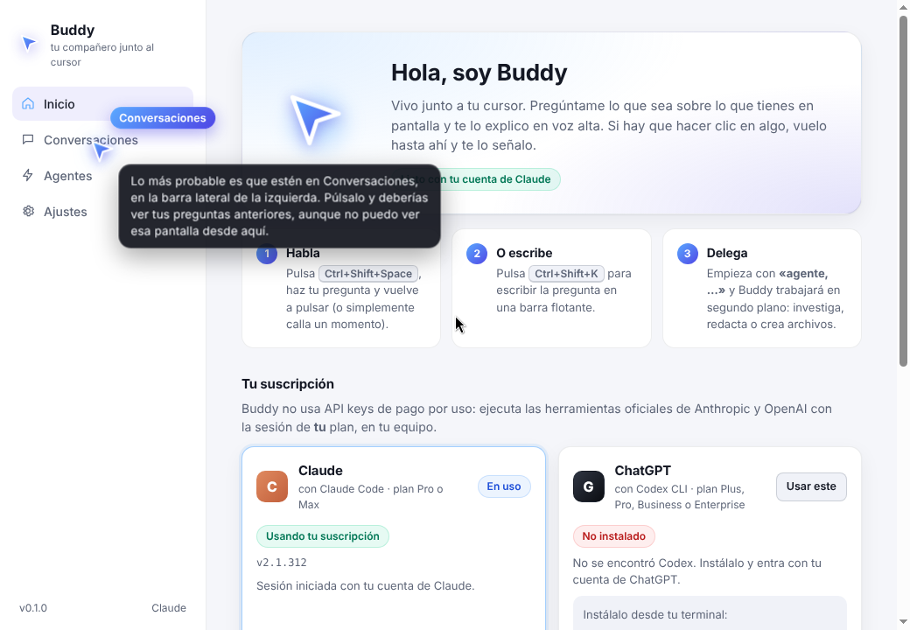
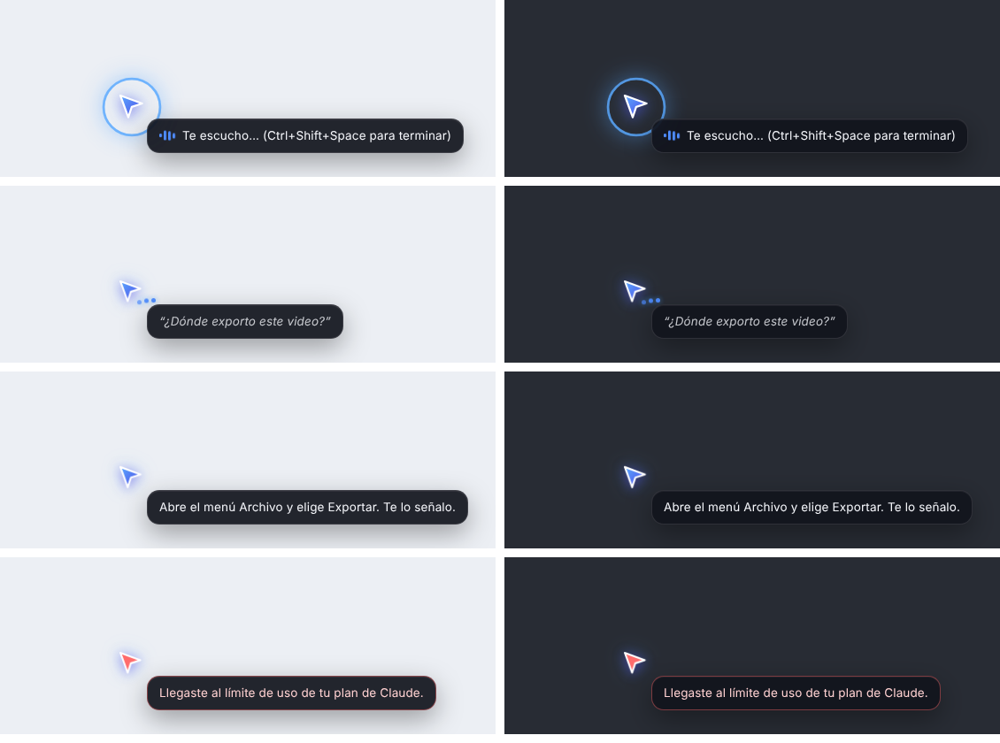
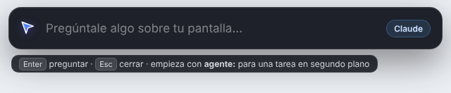

# Buddy: un clon de Clicky que usa tu suscripción de Claude o ChatGPT

Buddy es un compañero de IA que vive junto a tu cursor, inspirado en [Clicky](https://www.heyclicky.com/). Pulsas un atajo y le preguntas algo sobre lo que tienes en pantalla. Buddy ve tu pantalla, te responde en voz alta y, si hay que hacer clic en algo, vuela hasta ahí y te lo señala. También puede hacer tareas largas en segundo plano ("agente, investiga…").

Está hecho con **React + Electron** (TypeScript, Vite) y **no usa API keys de pago por uso**. Usa la suscripción que ya pagas:

| Proveedor | Cómo se conecta | Planes |
| --- | --- | --- |
| **Claude** | La CLI oficial **Claude Code** (`claude -p`), con la sesión que tú iniciaste | Pro, Max (y Team/Enterprise) |
| **ChatGPT** | La CLI oficial **Codex** (`codex exec`) con "Sign in with ChatGPT" | Plus, Pro, Business, Enterprise |



## Funciones

- **Pregunta con la voz.** Pulsa <kbd>⌘/Ctrl</kbd>+<kbd>⇧</kbd>+<kbd>Espacio</kbd>, habla y vuelve a pulsar, o simplemente quédate callado un momento. Tu voz se transcribe **en tu equipo** con Whisper (transformers.js con WebGPU o WASM).
- **Ve tu pantalla y te señala.** Captura el monitor donde está el cursor, se la manda al modelo y este responde con lo que hay que decir y, si hace falta, las coordenadas del elemento. El buddy vuela en arco hasta el elemento y muestra una etiqueta.
- **Responde en voz alta** con las voces del sistema y muestra subtítulos junto al cursor.
- **Barra para escribir.** Con <kbd>⌘/Ctrl</kbd>+<kbd>⇧</kbd>+<kbd>K</kbd> abres una barra flotante, como Spotlight, para escribir la pregunta.
- **Agentes en segundo plano.** Si empiezas con "agente, …", la tarea se ejecuta en su propia carpeta (`~/Documents/Buddy/agentes/…`). Ves su progreso en el panel y Buddy te avisa en voz alta al terminar.
- **Memoria corta.** Las últimas respuestas se usan como contexto durante 10 minutos.
- **Panel** con el estado de tu suscripción, las comprobaciones de permisos, el historial, los agentes y los ajustes (modelo, voz, idioma, atajos).





## Requisitos

- **Node.js 22.12 o superior** (para desarrollar o compilar).
- **macOS o Windows.** Linux funciona, pero el overlay transparente necesita un compositor de ventanas.
- Al menos una de estas CLIs, con tu sesión iniciada:
  - **Claude Code**: `curl -fsSL https://claude.ai/install.sh | bash` (macOS/Linux) o `irm https://claude.ai/install.ps1 | iex` (Windows). Luego ejecuta `claude auth login` y entra con tu cuenta Pro/Max.
  - **Codex**: `npm install -g @openai/codex`. Luego ejecuta `codex login` y elige **Sign in with ChatGPT**.

El panel detecta ambas CLIs, te dice si estás usando la suscripción o una API key y tiene un botón que abre la terminal con el comando de inicio de sesión.

## Uso

```bash
cd clicky-clone
npm install
npm run dev        # desarrollo con recarga en caliente
# o
npm run build && npm start
```

La primera vez se abre el panel. En macOS, concede estos permisos:

1. **Micrófono**: el sistema lo pide la primera vez que usas el atajo de voz.
2. **Grabación de pantalla**: Ajustes del Sistema → Privacidad y seguridad. Después reinicia Buddy.
3. **Automatización (Terminal)**: solo si usas el botón "Iniciar sesión en la terminal".

| Atajo por defecto | Acción |
| --- | --- |
| <kbd>⌘/Ctrl</kbd>+<kbd>⇧</kbd>+<kbd>Espacio</kbd> | Empezar o terminar de hablar (también corta solo al detectar silencio) |
| <kbd>⌘/Ctrl</kbd>+<kbd>⇧</kbd>+<kbd>K</kbd> | Escribir una pregunta |
| <kbd>⌘/Ctrl</kbd>+<kbd>⇧</kbd>+<kbd>.</kbd> | Abrir el panel |

Los atajos se cambian en **Ajustes**. Si pulsas el atajo de voz mientras Buddy habla, lo interrumpes.

## Cómo usa tu suscripción y qué no hace

Buddy **no** implementa su propio inicio de sesión, **no** lee, copia ni guarda tokens y **no** llama directamente a las APIs. Solo ejecuta en tu equipo los binarios oficiales sin modificar:

- **Respuestas rápidas.** Ejecuta `claude -p --input-format stream-json --tools "" --json-schema …`: la captura va como imagen por stdin y el modelo no tiene herramientas. Con ChatGPT ejecuta `codex exec --sandbox read-only --image … --output-schema …`.
- **Agentes.** Ejecuta `claude -p` con herramientas de archivos y web dentro de la carpeta de la tarea; la terminal solo se activa si lo permites en Ajustes. Con ChatGPT ejecuta `codex exec --sandbox workspace-write` en esa carpeta.
- **Sin API keys.** Antes de ejecutar las CLIs, quita del entorno `ANTHROPIC_API_KEY`, `OPENAI_API_KEY` y variables similares para que se use tu plan y no una API key.

> **Sobre los términos de uso.** Anthropic [permite](https://code.claude.com/docs/en/legal-and-compliance#authentication-and-credential-use) que cada persona use el binario oficial de Claude Code con su propia suscripción. En cambio, **no permite** que una app de terceros ofrezca el inicio de sesión de Claude.ai ni que canalice peticiones con credenciales de planes Free/Pro/Max **en nombre de sus usuarios**. Por eso Buddy está pensado para **uso personal**: cada persona lo ejecuta en su equipo con su propia sesión de la CLI. Si quieres distribuirlo como producto a otras personas, usa API keys (Claude Console u OpenAI Platform) y revisa los términos comerciales de cada proveedor. Los límites de uso de tu plan se aplican igual que si usaras la CLI directamente.

## Privacidad

- **Audio.** Nunca sale de tu equipo: Whisper corre localmente. La primera vez se descarga el modelo (~80 MB) desde huggingface.co.
- **Capturas.** Solo se toman cuando preguntas y se envían a Anthropic u OpenAI a través de su CLI, igual que cualquier imagen que les pases. Las últimas 6 capturas se guardan en la carpeta temporal del sistema.
- **Historial y tareas.** Se guardan en la carpeta de datos de la app (la ruta aparece en Ajustes).

## Arquitectura

```
src/
├─ main/                    Proceso principal (Node)
│  ├─ index.ts              Arranque, IPC, permisos, atajos, bandeja
│  ├─ assistant.ts          Flujo: escuchar → capturar → preguntar → señalar → hablar
│  ├─ capture.ts            Captura del monitor (desktopCapturer), ≤1.15 MP para que las coordenadas cuadren
│  ├─ agents.ts             Tareas en segundo plano con registro en vivo
│  ├─ providers/            claude.ts (Claude Code) y codex.ts (Codex CLI)
│  ├─ core/                 Lógica pura y probada: prompts, esquema, argumentos, parseo de eventos
│  ├─ windows.ts            Overlay por monitor, panel, barra de preguntas y motor de voz
│  └─ protocol.ts           app://bundle con aislamiento entre orígenes (WASM multihilo)
├─ preload/                 API segura `window.buddy` (contextIsolation + sandbox)
├─ renderer/                React
│  ├─ overlay/              El buddy: sigue al cursor, vuela en arco, subtítulos
│  ├─ voice/                Ventana oculta: micrófono + detección de silencio, Whisper en un worker, síntesis de voz
│  ├─ prompt/               Barra flotante para escribir
│  └─ panel/                Inicio, Conversaciones, Agentes y Ajustes
└─ shared/                  Tipos e IPC compartidos
```

El modelo responde siempre con este JSON (salida estructurada en ambas CLIs):

```json
{ "say": "Abre el menú Archivo y elige Exportar.", "point": { "x": 412, "y": 38, "label": "Archivo" } }
```

`x` e `y` están en píxeles de la captura. Buddy los convierte a coordenadas de pantalla del monitor correcto, teniendo en cuenta la escala HiDPI.

## Desarrollo

```bash
npm run typecheck   # TypeScript (main + renderer)
npm test            # pruebas unitarias de la lógica central (node:test)
npm run build       # compila a out/
npm run dist:mac    # instalador .dmg/.zip (también dist:win y dist:linux)
```

El empaquetado usa electron-builder (`electron-builder.yml`). La firma de código y la notarización de macOS no están configuradas: para distribuir el instalador tendrás que añadir tus certificados.

## Limitaciones conocidas

- Los atajos globales de Electron no detectan cuándo sueltas la tecla, así que el atajo de voz funciona como interruptor: una pulsación empieza y otra termina. También termina solo tras ~1.4 s de silencio.
- La calidad de la voz depende de las voces del sistema. En macOS puedes descargar voces "Mejoradas" en Accesibilidad → Contenido leído.
- En Linux, el overlay transparente necesita un compositor (GNOME, KDE, picom…).
