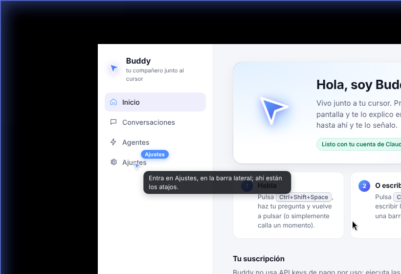
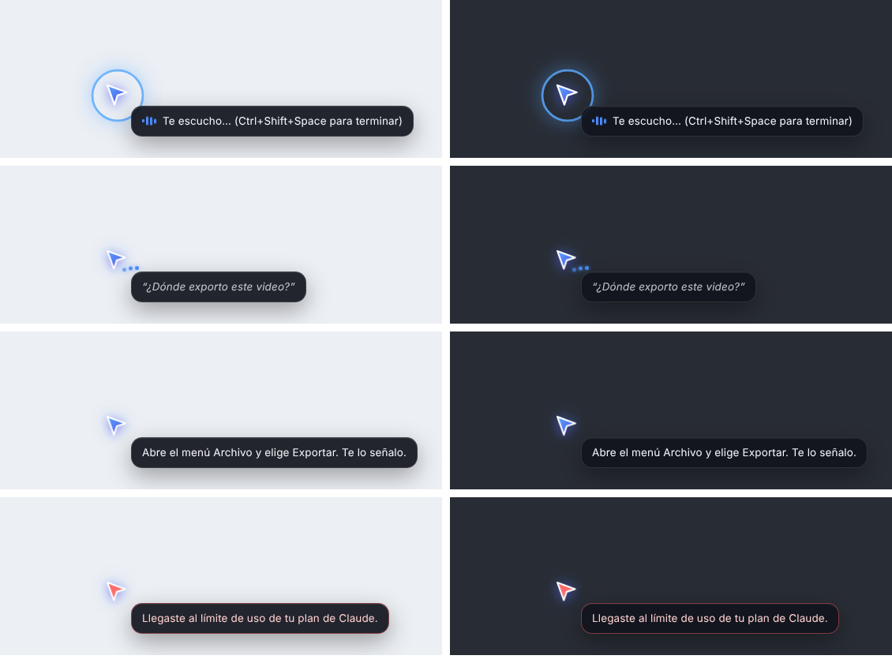
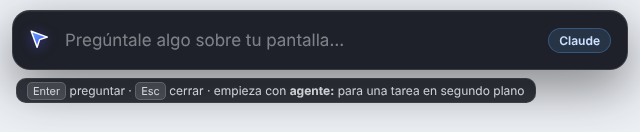
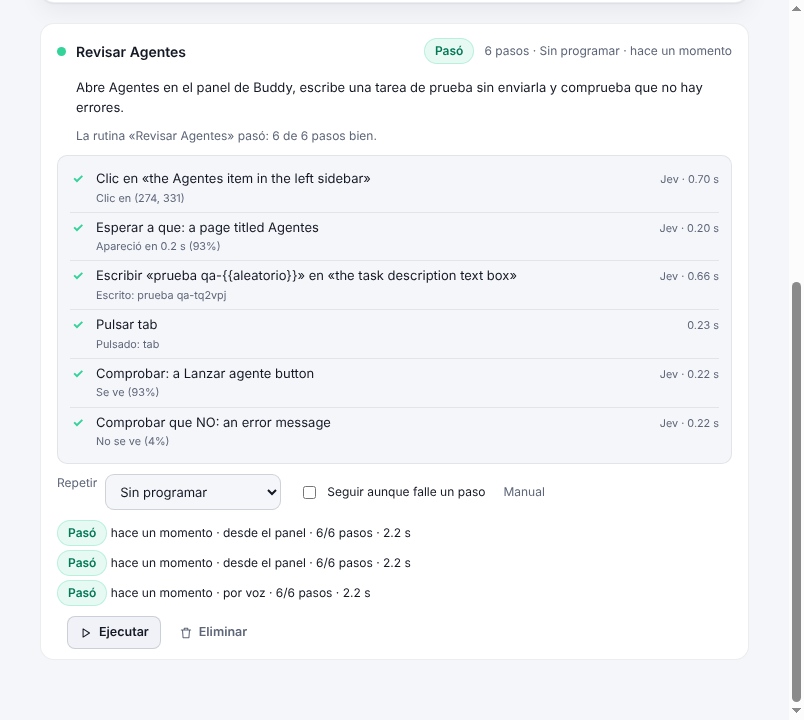

# Buddy: un clon de Clicky que usa tu suscripción de Claude o ChatGPT

Buddy es un compañero de IA que vive junto a tu cursor, inspirado en [Clicky](https://www.heyclicky.com/). Pulsas un atajo y le preguntas algo sobre lo que tienes en pantalla. Buddy ve tu pantalla, te responde en voz alta y, si hay que hacer clic en algo, vuela hasta ahí y te lo señala. También puede hacer tareas largas en segundo plano ("agente, investiga…").

Está hecho con **React + Electron** (TypeScript, Vite) y **no usa API keys de pago por uso**. Usa la suscripción que ya pagas:

| Proveedor | Cómo se conecta | Planes |
| --- | --- | --- |
| **Claude** | La CLI oficial **Claude Code** (`claude -p`), con la sesión que tú iniciaste | Pro, Max (y Team/Enterprise) |
| **ChatGPT** | La CLI oficial **Codex** (`codex exec`) con "Sign in with ChatGPT" | Plus, Pro, Business, Enterprise |



## Funciones

- **Pregunta con la voz.** Pulsa <kbd>⌘/Ctrl</kbd>+<kbd>⇧</kbd>+<kbd>Espacio</kbd>, habla y vuelve a pulsar, o simplemente quédate callado un momento. Tu voz se transcribe **en tu equipo** con Whisper (transformers.js con WebGPU o WASM).
- **Ve tu pantalla y te señala.** Captura el monitor donde está el cursor, se la manda al modelo y este responde con lo que hay que decir y, si hace falta, las coordenadas del elemento. El buddy vuela en arco hasta el elemento y muestra una etiqueta.
- **Responde en voz alta** con las voces del sistema y muestra subtítulos junto al cursor.
- **Discreto.** El buddy es una flecha pequeña con un hint compacto al lado ("Escuchando", "Pensando…" o la respuesta). Mientras escucha o trabaja, un brillo suave en el borde de la pantalla avisa de que está ocupado, para que no lo interrumpas; se puede desactivar en Ajustes. Mientras haya agentes trabajando en segundo plano, el buddy muestra un punto verde.
- **Barra para escribir.** Con <kbd>⌘/Ctrl</kbd>+<kbd>⇧</kbd>+<kbd>K</kbd> abres una barra flotante, como Spotlight, para escribir la pregunta.
- **Agentes en segundo plano.** Si empiezas con "agente, …", la tarea se ejecuta en su propia carpeta (`~/Documents/Buddy/agentes/…`). Ves su progreso en el panel y Buddy te avisa en voz alta al terminar.
- **Memoria corta.** Las últimas respuestas se usan como contexto durante 10 minutos.
- **Rutinas estilo QA.** Dile «crea una rutina que…» y Claude la define una vez; después Buddy la repite en segundos con Jev y tu teclado y ratón («ejecuta la rutina…»), también programada.
- **Claude como orquestador.** «Hazlo tú: …» lanza a Claude con las herramientas rápidas de Buddy para tareas largas en tu pantalla. Lo que funciona lo puede guardar como rutina.
- **En macOS, Apple Intelligence y el dictado de Apple** entienden mejor lo que dices y responden lo sencillo en tu equipo, sin gastar tu plan.
- **Panel** con el estado de tu suscripción, las comprobaciones de permisos, el historial, las rutinas, los agentes y los ajustes (modelo, voz, idioma, atajos).





## Requisitos

- **Node.js 22.12 o superior** (para desarrollar o compilar).
- **macOS o Windows.** Linux funciona, pero el overlay transparente necesita un compositor de ventanas.
- Al menos una de estas CLIs, con tu sesión iniciada:
  - **Claude Code**: `curl -fsSL https://claude.ai/install.sh | bash` (macOS/Linux) o `irm https://claude.ai/install.ps1 | iex` (Windows). Luego ejecuta `claude auth login` y entra con tu cuenta Pro/Max.
  - **Codex**: `npm install -g @openai/codex`. Luego ejecuta `codex login` y elige **Sign in with ChatGPT**.

El panel detecta ambas CLIs, te dice si estás usando la suscripción o una API key y tiene un botón que abre la terminal con el comando de inicio de sesión.

## Uso

```bash
cd clicky-clone
npm install
npm run dev        # desarrollo con recarga en caliente
# o
npm run build && npm start
```

La primera vez se abre el panel. En macOS, concede estos permisos:

1. **Micrófono**: el sistema lo pide la primera vez que usas el atajo de voz.
2. **Grabación de pantalla**: Ajustes del Sistema → Privacidad y seguridad. Después reinicia Buddy.
3. **Automatización (Terminal)**: solo si usas el botón "Iniciar sesión en la terminal".

| Atajo por defecto | Acción |
| --- | --- |
| <kbd>⌘/Ctrl</kbd>+<kbd>⇧</kbd>+<kbd>Espacio</kbd> | Empezar o terminar de hablar (también corta solo al detectar silencio) |
| <kbd>⌘/Ctrl</kbd>+<kbd>⇧</kbd>+<kbd>K</kbd> | Escribir una pregunta |
| <kbd>⌘/Ctrl</kbd>+<kbd>⇧</kbd>+<kbd>.</kbd> | Abrir el panel |

Los atajos se cambian en **Ajustes**. Si pulsas el atajo de voz mientras Buddy habla, lo interrumpes.

## Cómo usa tu suscripción y qué no hace

Buddy **no** implementa su propio inicio de sesión, **no** lee, copia ni guarda tokens y **no** llama directamente a las APIs. Solo ejecuta en tu equipo los binarios oficiales sin modificar:

- **Respuestas rápidas.** Ejecuta `claude -p --input-format stream-json --tools "" --json-schema …`: la captura va como imagen por stdin y el modelo no tiene herramientas. Con ChatGPT ejecuta `codex exec --sandbox read-only --image … --output-schema …`.
- **Agentes.** Ejecuta `claude -p` con herramientas de archivos y web dentro de la carpeta de la tarea; la terminal solo se activa si lo permites en Ajustes. Con ChatGPT ejecuta `codex exec --sandbox workspace-write` en esa carpeta.
- **Sin API keys.** Antes de ejecutar las CLIs, quita del entorno `ANTHROPIC_API_KEY`, `OPENAI_API_KEY` y variables similares para que se use tu plan y no una API key.

> **Sobre los términos de uso.** Anthropic [permite](https://code.claude.com/docs/en/legal-and-compliance#authentication-and-credential-use) que cada persona use el binario oficial de Claude Code con su propia suscripción. En cambio, **no permite** que una app de terceros ofrezca el inicio de sesión de Claude.ai ni que canalice peticiones con credenciales de planes Free/Pro/Max **en nombre de sus usuarios**. Por eso Buddy está pensado para **uso personal**: cada persona lo ejecuta en su equipo con su propia sesión de la CLI. Si quieres distribuirlo como producto a otras personas, usa API keys (Claude Console u OpenAI Platform) y revisa los términos comerciales de cada proveedor. Los límites de uso de tu plan se aplican igual que si usaras la CLI directamente.

## Experimento: señalar más rápido con Jev

[Jev](https://typesafe.ai) es el modelo de TypeSafe AI. No genera texto: responde preguntas tipadas (sí/no, opciones, cajas sobre una imagen) en ~0.1–0.5 s. Buddy puede usarlo **solo para señalar**: lo que te dice sigue viniendo de Claude o ChatGPT.

Cómo funciona cuando lo activas (Ajustes → "Señalar más rápido con Jev"):

1. Con la captura lista, Buddy lanza **a la vez** la pregunta a Claude/ChatGPT y una petición a Jev (`jev-preview`) con dos preguntas: si hay algo que señalar (`noul`) y dónde está (`box`).
2. Si Jev está seguro, el buddy vuela al elemento en cuanto Jev contesta, sin esperar a la respuesta hablada.
3. Cuando llega la respuesta de Claude/ChatGPT, esta tiene la última palabra: si dice que no hace falta señalar, el buddy vuelve al cursor; si no, pone su etiqueta. Si Jev no estaba seguro, falló o no está configurado, se usa el punto del modelo principal, como siempre.
4. En **Conversaciones** verás cuánto tardó Jev y a cuántos píxeles quedó del punto del modelo, para comparar.

En pruebas con Electron, Claude real y un servidor que imita la API de Jev, el buddy señaló a los ~0.3 s, frente a los 3–4 s que tarda Claude en responder. La precisión real de Jev no se ha medido todavía: depende de su API, que no fue accesible desde el entorno de pruebas.

Requisitos y avisos:

- Necesita una API key de TypeSafe, que es **de pago por uso** y no tiene que ver con tu suscripción. Se guarda cifrada en tu equipo con el llavero del sistema; también puedes definir `TYPESAFE_API_KEY`.
- La captura de pantalla se envía a TypeSafe (además de a Anthropic u OpenAI).
- El soporte de imágenes de Jev es experimental en su API (cabecera `TypeSafe-Danger-Zone-Images`) y puede cambiar.

## Apple Intelligence, rutinas y Claude como orquestador

Cada petición la atiende quien la resuelve más rápido. Tu suscripción de Claude queda para lo que de verdad lo necesita:

| Quién | Dónde corre | Para qué |
| --- | --- | --- |
| **Dictado de Apple** (SpeechAnalyzer) | Tu Mac | Transcribe mientras hablas y muestra el texto en el hint. Si falla, Whisper. |
| **Apple Intelligence** (Foundation Models) | Tu Mac, gratis | Corrige el dictado con el texto de la pantalla y tus rutinas, decide quién responde y contesta lo sencillo. En macOS 27 también ve la captura. |
| **Jev** (TypeSafe) | API de pago por uso | Sí/no y localizar elementos en ~0.3 s: señalar, y los pasos de las rutinas. |
| **Claude / ChatGPT** | Tu suscripción | Preguntas complejas, definir rutinas y orquestar tareas largas. |



Así se reparte una petición:

1. **Frases de mando**, sin ningún modelo: «ejecuta la rutina login», «crea una rutina que…», «hazlo tú: …», «agente, …».
2. **Apple Intelligence** recibe la frase, el texto visible (OCR con Vision) y los nombres de tus rutinas, y devuelve la frase corregida y una decisión. Si es una pregunta sencilla y está seguro, Buddy responde ya. Señala con Jev o con el texto reconocido en pantalla.
3. **Lo demás va a Claude o ChatGPT**, como siempre, con la frase corregida.

### Rutinas (tareas repetitivas estilo QA)

- **Crear.** Por voz («crea una rutina que entre a localhost:3000, inicie sesión con demo y compruebe que aparece el tablero») o en **Rutinas → Crear con Claude**. Claude la convierte en pasos con salida estructurada: `open`, `click`, `type`, `key`, `scroll`, `wait`, `waitFor`, `check` (también «que **no** se vea»), `point`, `say` y `ask`. Al escribir se pueden usar `{{aleatorio}}`, `{{fecha}}`, `{{hora}}` y `{{timestamp}}`, por ejemplo para correos únicos.
- **Ejecutar.** «Ejecuta la rutina …» (aunque el dictado se equivoque un poco con el nombre) o el botón del panel. Cada paso visual es una pregunta a Jev; los clics y el teclado los hace el ayudante de macOS. No vuelve a llamar a Claude, salvo en los pasos `ask` o si Jev no está seguro y lo permites en Ajustes.
- **Informe.** Paso a paso, con lo que vio Jev, cuánto tardó y una captura del fallo. Buddy te dice el resultado en voz alta.
- **Programar.** Cada 15/30/60 min o a una hora diaria, mientras Buddy está abierto. Si la rutina usa el ratón, avisa 5 s antes y puedes cancelarla con <kbd>Esc</kbd>.
- **Detener.** Pulsa <kbd>Esc</kbd>, mueve el ratón o usa el atajo de voz.

### Claude como orquestador

«Hazlo tú: …» lanza Claude Code (tu suscripción) con un servidor **MCP** local de Buddy. Claude decide y Buddy actúa rápido:

- `screen_check`, `screen_find`, `wait_for`: Jev.
- `screen_read`: OCR en tu Mac.
- `screen_look`: la captura, para que Claude la vea.
- `click`, `type_text`, `press_keys`, `scroll`, `open`: tu teclado y ratón.
- `say`, `list_routines`, `run_routine`, `save_routine`.

Si la tarea se puede repetir, Claude la guarda como rutina y la próxima vez la hace Buddy solo. Mientras trabaja, el borde de la pantalla brilla; <kbd>Esc</kbd> o mover el ratón lo detienen. El servidor MCP solo escucha en `127.0.0.1`, con un token nuevo cada vez que abres Buddy.

### Requisitos en macOS

- **macOS 26 (Tahoe) o superior** para el dictado de Apple y Apple Intelligence. Con macOS 27, Apple Intelligence también ve la captura.
- **Apple Intelligence activado** (Ajustes del Sistema → Apple Intelligence y Siri) y un Mac con chip de Apple. Sin él, Buddy sigue funcionando con Whisper y tu suscripción.
- **Compilar el ayudante nativo** una vez, con Xcode 26 o superior: `npm run build:apple`. `npm run dist:mac` lo compila y lo mete en la app.
- **Accesibilidad**, para que las rutinas y el orquestador hagan clics y escriban: Ajustes → «Dar permiso de Accesibilidad». Con `npm run dev`, el permiso es de la app de terminal desde la que lo lanzas.

En Linux, las rutinas usan `xdotool` si está instalado. En Windows todavía no hacen clics: solo miran y señalan.

### Avisos

- Las respuestas en el equipo dependen de un modelo pequeño. Buddy solo las usa cuando Apple Intelligence dice estar seguro, y puedes desactivarlas en Ajustes.
- Una rutina o el orquestador **usan tu teclado y ratón de verdad**: no lo dejes en pantallas con datos que no quieras tocar. Las instrucciones piden a Claude no hacer nada destructivo (borrar, pagar, enviar mensajes) si no lo pediste, pero el texto de una página podría intentar engañarlo. Por eso puedes detenerlo en cualquier momento.
- **Qué está probado.**
  - El ayudante en Swift compila y pasa una prueba de humo con Xcode 26 y Xcode 27 en GitHub Actions: estado, OCR, esquemas, errores y dictado.
  - El flujo completo (enrutado, dictado en streaming, rutinas, informes y MCP con Claude real) está probado en Linux con un ayudante simulado.
  - **Falta medir** la calidad y la latencia reales de Apple Intelligence y del dictado en un Mac: las máquinas virtuales de la CI no tienen Apple Intelligence.

## Privacidad

- **Audio.** Nunca sale de tu equipo: el dictado de Apple y Whisper corren localmente. La primera vez se descarga el modelo (el de Apple lo descarga macOS; el de Whisper, ~80 MB, desde huggingface.co).
- **Apple Intelligence y OCR.** Corren en tu Mac: el texto de tu pantalla no sale de él.
- **Capturas.** Solo se toman cuando preguntas y se envían a Anthropic u OpenAI a través de su CLI, igual que cualquier imagen que les pases, y a TypeSafe si usas Jev (para señalar o en los pasos de las rutinas). Las últimas 6 capturas se guardan en la carpeta temporal del sistema.
- **Historial y tareas.** Se guardan en la carpeta de datos de la app (la ruta aparece en Ajustes).

## Arquitectura

```
src/
├─ main/                    Proceso principal (Node)
│  ├─ index.ts              Arranque, IPC, permisos, atajos, bandeja
│  ├─ assistant.ts          Flujo: escuchar → capturar → preguntar → señalar → hablar
│  ├─ capture.ts            Captura del monitor (desktopCapturer), ≤1.15 MP para que las coordenadas cuadren
│  ├─ agents.ts             Tareas en segundo plano con registro en vivo
│  ├─ apple.ts              Ayudante de macOS: Apple Intelligence, dictado, OCR y teclado/ratón
│  ├─ routines.ts           Rutinas: crear con Claude, ejecutar, programar, informes
│  ├─ orchestrator.ts       Claude como orquestador: herramientas MCP de Buddy
│  ├─ mcp-server.ts         Servidor MCP local (HTTP en 127.0.0.1 con token)
│  ├─ vision.ts             Jev para ver y localizar (con el modelo de respaldo)
│  ├─ screen-guard.ts       Esc o mover el ratón detiene lo que use la pantalla
│  ├─ providers/            claude.ts (Claude Code) y codex.ts (Codex CLI)
│  ├─ core/                 Lógica pura y probada: prompts, esquemas, enrutador, rutinas, MCP, protocolo
│  ├─ windows.ts            Overlay por monitor, panel, barra de preguntas y motor de voz
│  └─ protocol.ts           app://bundle con aislamiento entre orígenes (WASM multihilo)
├─ preload/                 API segura `window.buddy` (contextIsolation + sandbox)
├─ renderer/                React
│  ├─ overlay/              El buddy: sigue al cursor, vuela en arco, subtítulos
│  ├─ voice/                Ventana oculta: micrófono + detección de silencio, Whisper en un worker, síntesis de voz
│  ├─ prompt/               Barra flotante para escribir
│  └─ panel/                Inicio, Conversaciones, Agentes y Ajustes
└─ shared/                  Tipos e IPC compartidos
native/apple/                Ayudante en Swift (Foundation Models, SpeechAnalyzer, Vision, CGEvent)
```

El modelo responde siempre con este JSON (salida estructurada en ambas CLIs):

```json
{ "say": "Abre el menú Archivo y elige Exportar.", "point": { "x": 412, "y": 38, "label": "Archivo" } }
```

`x` e `y` están en píxeles de la captura. Buddy los convierte a coordenadas de pantalla del monitor correcto, teniendo en cuenta la escala HiDPI.

## Desarrollo

```bash
npm run typecheck   # TypeScript (main + renderer)
npm test            # pruebas unitarias de la lógica central (node:test)
npm run build       # compila a out/
npm run build:apple # compila el ayudante de macOS (Xcode 26 o superior)
npm run dist:mac    # instalador .dmg/.zip con el ayudante (también dist:win y dist:linux)
```

Para probar todo sin Mac, `test/fixtures/fake-apple-helper.mjs` imita el ayudante (`BUDDY_APPLE_HELPER=…`); la skill `run-buddy` lo usa para las pruebas de punta a punta.

El empaquetado usa electron-builder (`electron-builder.yml`). La firma de código y la notarización de macOS no están configuradas: para distribuir el instalador tendrás que añadir tus certificados.

## Limitaciones conocidas

- Los atajos globales de Electron no detectan cuándo sueltas la tecla, así que el atajo de voz funciona como interruptor: una pulsación empieza y otra termina. También termina solo tras ~1.4 s de silencio.
- La calidad de la voz depende de las voces del sistema. En macOS puedes descargar voces "Mejoradas" en Accesibilidad → Contenido leído.
- En Linux, el overlay transparente necesita un compositor (GNOME, KDE, picom…).
